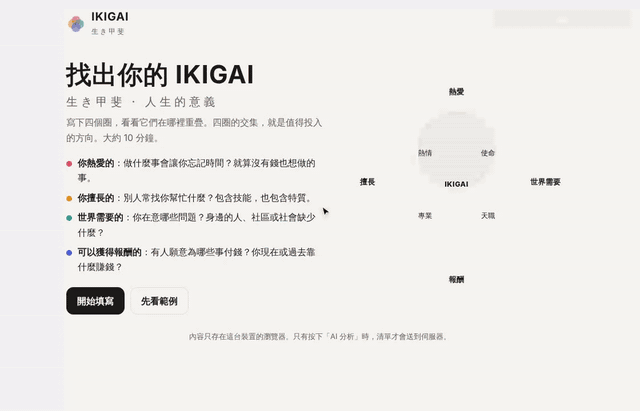

# IKIGAI 網頁版：操作彙整

IKIGAI（生き甲斐）是用四個圈找出人生方向的方法：**你熱愛的**、**你擅長的**、**世界需要的**、**可以獲得報酬的**。四個圈的交集就是你的 IKIGAI。

這個網頁版做在 LINE Bot 同一個專案裡，部署到 Vercel 後就能用瀏覽器開啟，不需要另外架站。

- 網址：`https://<你的-vercel-網域>/ikigai`
- 本機：`http://localhost:3000/ikigai`



---

## 一、使用者操作流程

第一次打開會先看到介紹頁：按「**開始填寫**」從第 1 步開始，或按「**先看範例**」載入一組範例，直接看結果長什麼樣子。

| 步驟 | 畫面 | 要做的事 |
| --- | --- | --- |
| 1 | 熱愛 | 寫下做了會忘記時間、就算沒有錢也想做的事 |
| 2 | 擅長 | 寫下別人常找你幫忙的事，包括技能和特質 |
| 3 | 世界需要 | 寫下你在意的問題，或身邊的人、社區、社會缺少的東西 |
| 4 | 報酬 | 寫下有人願意付錢的事，例如職業、服務、接案 |
| 5 | 交集對照 | 點每一項旁的彩色按鈕，標出它還屬於哪些圈，也可以填補充說明（選填） |
| 6 | 結果 | 看統計數字、四圈圖、交集清單和下一步建議，按「AI 分析」，再存檔或分享 |

- **進度條**：畫面上方。可以隨時點選跳到任一步，寫過的步驟會打勾。
- **按鈕列**：固定在畫面下方，用來前進或返回。電腦上也可以用鍵盤 ← → 方向鍵。
- **自動儲存**：每次修改都會存到瀏覽器，右上角會短暫顯示「已自動儲存」。

### 新增項目的方式

- 在輸入框打字，按 **Enter** 或「新增」。
- 一次輸入多項：用逗號（`,` `，`）、頓號（`、`）或換行分隔。也可以直接貼上一整段多行清單。
- 每一步都有三個**提示問題**，想不出來時可以參考。
- 點「**靈感**」標籤，一鍵加入範例。
- 點「**其他圈已寫過的**」，把同一項加到這個圈。同一項只會存一次，系統會自動記下它屬於哪幾個圈。
- 點標籤上的 **×**，就會從這個圈移除。按錯了，點畫面下方提示裡的「**復原**」。項目從所有圈都移除後會自動刪掉。
- 標籤旁的小圓點，代表這一項也在其他哪些圈。
- 每個圈最多 20 項，每項最多 60 字。

### 交集對照（第 5 步）

- 每一項旁有四個彩色按鈕（熱愛、擅長、世界需要、報酬），點一下切換。屬於越多圈，這一項越靠近中心。
- 項目名稱旁的四個小點，代表目前屬於幾個圈。
- 上方可以篩選「只在 1 圈」或「跨圈」的項目，方便逐一檢查。
- 每一項至少要保留一個圈；不要的項目請回到該圈刪除。
- 補充說明（最多 300 字）可以寫目前職業、年資、限制等，AI 分析時會參考。

### 結果頁（第 6 步）

**統計數字**：最上方顯示 IKIGAI 中心、差一圈、跨圈項目各有幾項。下方的「下一步建議」會依結果提示接下來該補哪裡。

**四圈圖**：點圖上的區域，可以篩選右側清單。再點一次，或按「顯示全部」，就會取消篩選。

| 區域 | 組合 | 意義 |
| --- | --- | --- |
| 熱情 Passion | 熱愛 × 擅長 | 做起來開心又做得好 |
| 使命 Mission | 熱愛 × 世界需要 | 讓你覺得有意義 |
| 專業 Profession | 擅長 × 報酬 | 能穩定賺錢的能力 |
| 天職 Vocation | 世界需要 × 報酬 | 市場願意付錢解決的問題 |
| **IKIGAI 中心** | 四圈全中 | 最值得投入的方向 |

**交集清單**：依照項目所在的位置分組。

- **IKIGAI 中心**：四圈全中。
- **差一圈**：中了三圈，並標出缺哪一圈：
  - 缺「世界需要」：滿足，但覺得自己沒那麼有用。
  - 缺「報酬」：喜悅又充實，但還不富裕。
  - 缺「擅長」：興奮，但能力還不確定。
  - 缺「熱愛」：舒適，但可能感到空虛。
- **兩圈交集**：熱情、使命、專業、天職，加上「熱愛 × 報酬」和「擅長 × 世界需要」。
- **只在一個圈**：建議回到交集對照，看看能不能多勾一圈。

**AI 分析**（至少要填兩個圈）：AI 會用繁體中文回覆四個部分：

1. 四個交集的觀察
2. 2 到 3 個可能的 IKIGAI 方向，並說明對應到哪些項目
3. 最薄弱的圈與補強建議
4. 接下來 30 天可以做的 3 個小行動

分析中會顯示進度動畫。失敗時，錯誤訊息旁有「**重試**」和「**複製提示詞**」：後者會把清單和分析指示複製起來，可以直接貼到 ChatGPT、Claude 或其他 AI 助理。結果頁上方的「複製提示詞」按鈕隨時都能用。

**存檔與分享**

| 按鈕 | 功能 |
| --- | --- |
| 複製文字 | 把四圈、交集和 AI 分析整理成純文字，複製到剪貼簿。可以貼到 LINE 或筆記 |
| 匯出 JSON | 下載 `ikigai-日期.json` 備份檔 |
| 匯入 JSON | 讀回備份檔，換裝置或還原時使用 |
| 列印 / 存成 PDF | 用瀏覽器列印，按鈕和導覽列會自動隱藏 |
| 全部清除 | 確認後清空所有內容，無法復原 |

### 資料與隱私

- 內容會自動存在這台裝置瀏覽器的 `localStorage`（鍵名 `ikigai:v1`）。重新整理或關掉再開都會保留。
- 換瀏覽器、換裝置、使用無痕模式或清除網站資料後，內容就不見了。重要內容請先「匯出 JSON」。
- 只有按「AI 分析」時，四圈清單和補充說明才會送到伺服器，再轉給 AI 模型。伺服器不會儲存這些內容。
- 有開啟 `OPENAI_MODERATION_ENABLED` 時，送出的內容會先經過安全檢查。

---

## 二、部署與設定（管理者）

### 1. 部署

這個專案原本就部署在 Vercel，推上 GitHub 後會自動重新部署，不需要新增服務。

- `vercel.json` 已設定 `includeFiles: "web/**"`，網頁檔會一起打包進 Function。
- 用 Docker 部署時，`Dockerfile` 會複製整個專案，不需要額外設定。

### 2. 環境變數（全部選填）

| 變數 | 預設 | 說明 |
| --- | --- | --- |
| `IKIGAI_ENABLED` | `true` | 設 `false` 會關閉整個 `/ikigai`，回傳 404 |
| `IKIGAI_AI_ENABLED` | `true` | 設 `false` 會關閉 AI 分析，網頁仍可使用，按鈕會停用 |
| `IKIGAI_MAX_TOKENS` | `1200` | AI 回覆的長度上限，實際會取它和 `OPENAI_COMPLETION_MAX_TOKENS` 中較大的值 |
| `IKIGAI_RATE_LIMIT` | `10` | 每個 IP 每小時最多分析幾次 |
| `IKIGAI_TIMEOUT` | `50000` | 等 AI 回覆的時間上限（毫秒），不受 `OPENAI_TIMEOUT` 影響。要小於 Vercel 的 60 秒上限 |

AI 分析沿用 LINE Bot 的聊天模型設定：`OPENAI_API_KEY`、`OPENAI_COMPLETION_MODEL`，或是 `OPENAI_COMPLETION_BASE_URL` 加上 `OPENAI_COMPLETION_API_KEY`。如果沒有設定 API 金鑰，AI 分析按鈕會停用。

> 次數限制存在 Function 的記憶體裡。Vercel 的多個執行個體不會共用，所以只能減緩濫用，不是嚴格限制。網址公開分享時，建議在 OpenAI 後台設定用量上限。

修改環境變數後，需要到 Vercel **Redeploy**，新設定才會生效。

### 3. 本機測試

```bash
npm ci
```

```bash
NODE_ENV=development APP_PORT=3000 npm start
```

開啟 `http://localhost:3000/ikigai`。在 `development` 模式下，AI 分析會回傳模擬文字「OK!」，不會呼叫 OpenAI，也不會花費額度。要測試真正的 AI 回覆，請在 `.env` 填好 `OPENAI_API_KEY`，再不加 `NODE_ENV` 啟動。

```bash
npx jest tests/ikigai.test.js
```

---

## 三、API

| 方法 | 路徑 | 說明 |
| --- | --- | --- |
| `GET` | `/ikigai` | 網頁本體 |
| `GET` | `/ikigai/status` | `{ "ai": true }`，表示 AI 分析是否可用 |
| `POST` | `/ikigai/analyze` | AI 分析 |

`POST /ikigai/analyze` 請求內容：

```json
{
  "love": ["寫作", "學習新知"],
  "good": ["寫作", "教學"],
  "need": ["教育資源"],
  "paid": ["課程講師"],
  "note": "目前是工程師，想轉職"
}
```

回應：

- `200 { "text": "## 1. 四個交集 ..." }`：Markdown 格式的分析。
- 失敗時回傳 `{ "code": "...", "error": "給使用者看的原因" }`：
  - `400`：`invalid_input`（填寫不到兩個圈、某一圈超過 20 項）、`flagged`（未通過安全檢查）
  - `403`：`disabled`（AI 分析已關閉）
  - `429`：`too_many_requests`（超過每小時次數上限。填寫不完整的請求不計入）
  - `502`：呼叫 AI 失敗，`code` 的意思見下方「疑難排解」

---

## 四、疑難排解：AI 分析的錯誤訊息

AI 分析失敗時，按鈕旁邊會用紅字直接顯示原因。畫面不會顯示 OpenAI 回傳的原文，因為原文可能含有部分金鑰；完整原文會記在 Vercel Logs，開頭是 `[ikigai]`。

| 畫面訊息 | `code` | 處理方式 |
| --- | --- | --- |
| OpenAI API 金鑰無效或已失效 | `invalid_api_key` | 到 OpenAI 後台重新產生金鑰，更新 Vercel 的 `OPENAI_API_KEY`，再重新部署 |
| OpenAI 額度用完了 | `insufficient_quota` | 到 OpenAI 後台的 Billing 儲值或提高上限 |
| OpenAI 目前請求太頻繁 | `rate_limited` | 過一分鐘再試 |
| 找不到模型「…」 | `model_not_found` | 檢查 `OPENAI_COMPLETION_MODEL` 拼字，或確認帳號能用這個模型 |
| 沒有權限使用模型「…」 | `forbidden` | 帳號或專案沒有開通該模型，或所在地區不支援 |
| OpenAI 拒絕了這次請求（參數 …） | `bad_request` | 模型不支援某個設定，例如 temperature，請依括號內的參數名稱調整對應的環境變數 |
| AI 服務暫時異常（狀態碼 5xx） | `upstream_error` | OpenAI 端的問題，稍後再試 |
| AI 回應逾時 | `timeout` | 把 `IKIGAI_TIMEOUT` 調高，或把 `IKIGAI_MAX_TOKENS` 調低 |
| 伺服器連不到 AI 服務 | `network` | 檢查 `OPENAI_COMPLETION_BASE_URL`／`OPENAI_BASE_URL` 網址 |
| AI 沒有回傳內容 | `empty_response` | 再試一次；一直發生的話，換一個模型 |
| 安全檢查失敗：… | （同上） | 安全檢查（moderation）呼叫失敗。可以先把 `OPENAI_MODERATION_ENABLED` 設為 `false` |
| 伺服器執行超過時間上限（504） | — | Vercel Function 超過 60 秒，請調低 `IKIGAI_MAX_TOKENS` |
| 分析次數太多 | `too_many_requests` | 等一小時，或調高 `IKIGAI_RATE_LIMIT` |
| 連不到伺服器 | — | 使用者端網路問題 |

---

## 五、檔案位置

| 檔案 | 內容 |
| --- | --- |
| `web/ikigai.html` | 網頁本體（單一檔案，HTML + CSS + JS，沒有外部相依） |
| `web/ikigai.js` | Express 路由：頁面、狀態、AI 分析、次數限制 |
| `utils/analyze-ikigai.js` | 輸入驗證、AI 提示詞、呼叫模型 |
| `api/index.js` | 掛載 `/ikigai` 路由 |
| `config/index.js` | `IKIGAI_*` 設定 |
| `tests/ikigai.test.js` | 測試 |

想修改 AI 回答的格式或語氣，請編輯 `utils/analyze-ikigai.js` 裡的 `buildIkigaiMessages`。想修改靈感範例或區域說明，請編輯 `web/ikigai.html` 開頭的 `CIRCLES`、`PAIRS`、`TRIPLES`。
