# 孕期到出生：完整操作流程

> 一位媽媽從懷孕 8 週 → 產檢 → 中期篩檢 → 後期胎動 → 足月宮縮 → 破水 → 生產 → 坐月子 → 產後 6 週，在 App 裡實際操作的每一步。
> 這份流程同時是自動測試（`tests/journey.playwright.cjs`，22 項檢查全部通過），截圖由測試自動產生。

## 每個階段可以記錄什麼、要注意什麼

| 階段 | 記錄 | 注意事項（出現就就醫） |
|---|---|---|
| 懷孕初期 0–13 週 | 身體狀況日記（症狀、血壓、心情）、第 1–3 次產檢紀錄、葉酸打卡、體重 | 陰道出血或劇烈腹痛、吐到無法進食、發燒、單側下腹劇痛 |
| 懷孕中期 14–27 週 | 產檢（妊娠糖尿病、貧血篩檢）、體重曲線、第一次胎動 | 出血或破水、未滿 37 週規律宮縮、頭痛視力模糊＋突然水腫、血壓 ≥140/90 |
| 懷孕後期 28–36 週 | 每天胎動計數、GBS 篩檢、待產包清單 | 早產徵兆、胎動減少、子癲前症、出血、手掌腳底劇癢 |
| 足月待產 37 週＋ | 宮縮計時（5-1-1）、待產包 | 破水（直接去醫院）、大量出血、規律宮縮、胎動減少 |
| 生產 | 生產紀錄（時間、體重、身長、頭圍、方式、醫院、週數） | 產後大量出血；寶寶呼吸急促、發紫、24 小時內黃疸 |
| 坐月子 0–6 週 | 媽媽：惡露、傷口疼痛、體溫、心情；寶寶：餵奶、尿布、睡眠、體重、疫苗與篩檢 | 發燒、惡露異常、傷口紅腫、單側小腿腫痛、胸痛、乳腺炎、情緒低落超過 2 週 |

記錄到警訊時 App 會立刻提示：⚠️ 留意 → 「請盡快聯絡醫師」；🚨 嚴重 → 「請立即就醫」＋一鍵撥 119；心理危機 → 孕產婦關懷專線 0800-870-870、安心專線 1925。

## 一、懷孕初期（8 週）

### 1. 開始使用

選「懷孕中」，填最後一次月經第一天，App 自動算出預產期。

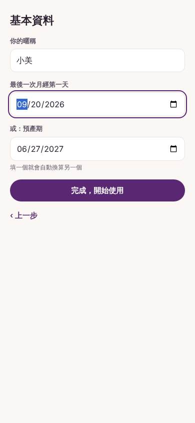

### 2. 懷孕 8 週的首頁

首頁：孕週與寶寶大小、孕產路線圖（這階段該做的事＋注意事項）、今日小任務。

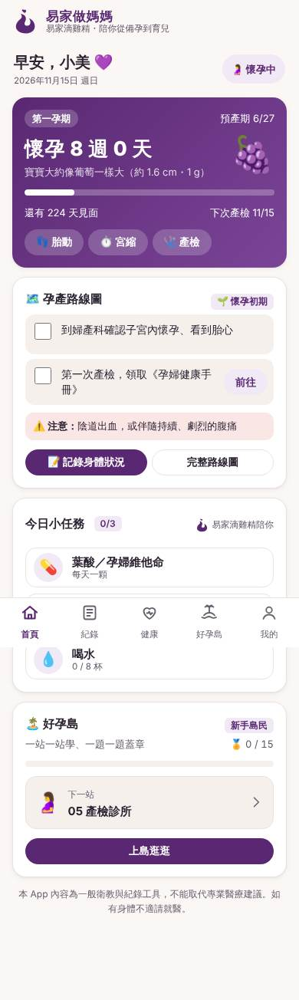

### 3. 記錄身體狀況

點「記錄身體狀況」：勾選症狀、心情、血壓（選填）。⚠️ 標記的是需要就醫的警訊。

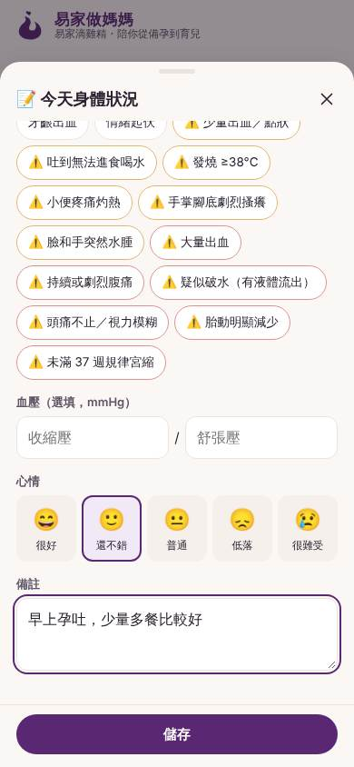

### 4. 第 1 次產檢紀錄

紀錄 → 產檢：記下體重、胎心、血壓、醫師交代。體重會自動放進孕期體重曲線。

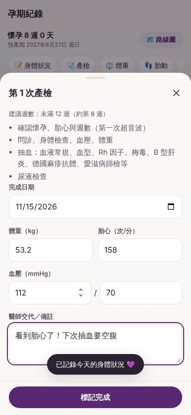

### 5. 孕產路線圖

路線圖：目前在「懷孕初期」，勾選完成的事；紅色區塊是這階段要就醫的警訊。

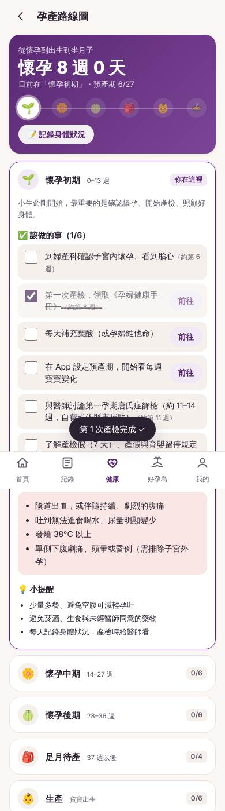

### 6. 孕期紀錄

「紀錄」分頁：身體狀況、產檢、體重、胎動、宮縮都在同一條時間軸，產檢時直接給醫師看。

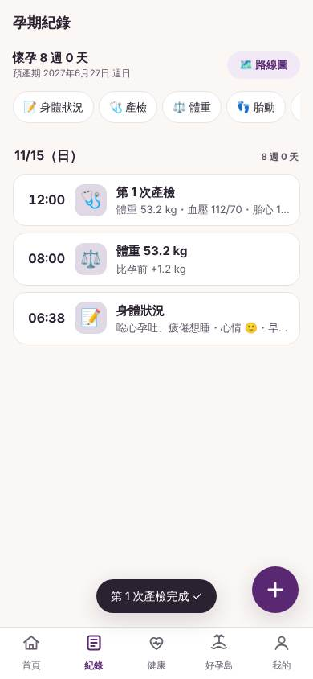

### 7. 懷孕 22 週

過了 14 週：首頁自動換成「懷孕中期」該做的事（高層次超音波、妊娠糖尿病篩檢…）。

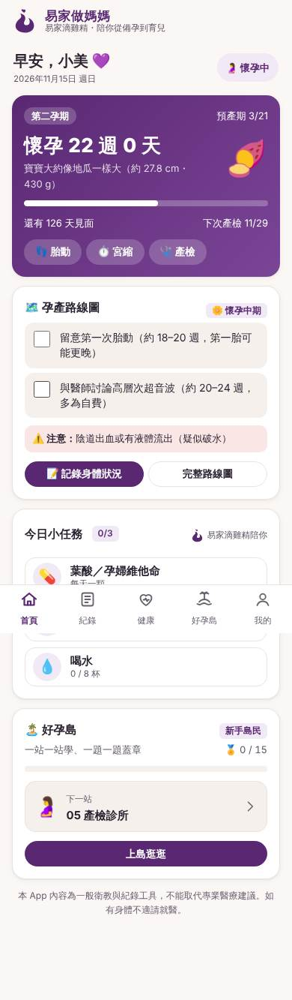

## 二、懷孕中期（22 週）

### 8. 警訊提醒（盡快就醫）

記錄到血壓 ≥140/90、突然水腫：App 立刻提醒「請盡快聯絡醫師」（子癲前症警訊）。

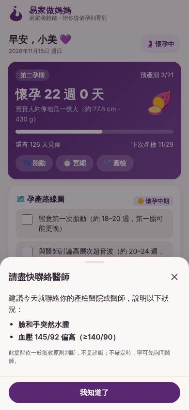

### 9. 胎動計數

32 週：每天數胎動，數到 10 下就完成。胎動明顯減少要立即就醫。

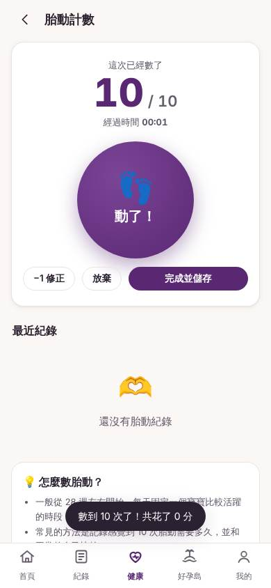

## 三、懷孕後期（32 週）

### 10. 待產包

待產包清單：證件、媽媽用品、寶寶用品一次備齊。

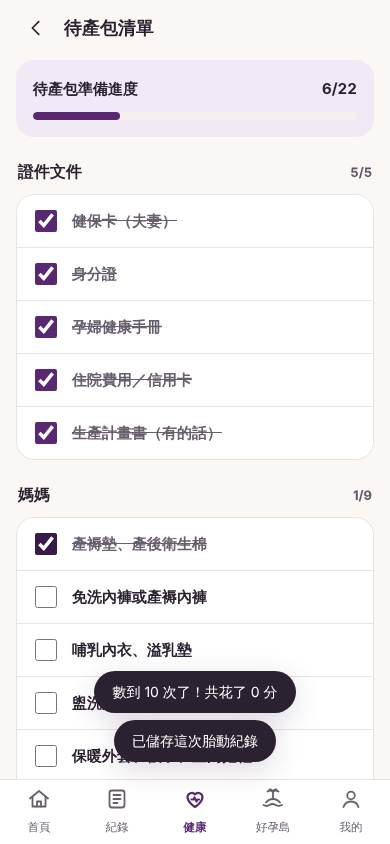

### 11. 宮縮計時

39 週：用宮縮計時器記錄。每 5 分鐘一次、每次約 1 分鐘、持續 1 小時（5-1-1）→ App 提醒準備去醫院。

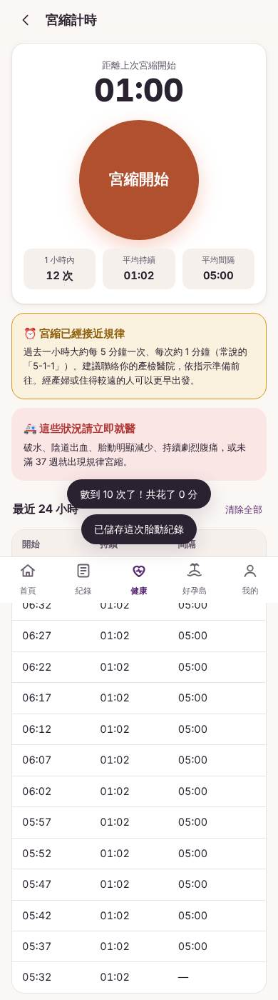

## 四、足月待產（39 週）

### 12. 警訊提醒（立即就醫）

記錄「疑似破水」：App 提醒立即前往醫院，並提供一鍵撥打 119。

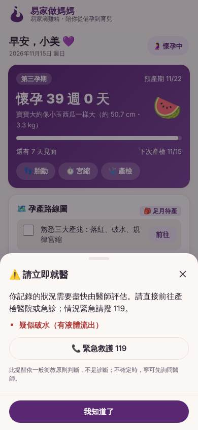

### 13. 孕期紀錄（含警訊）

紀錄分頁會標出「需就醫／留意」的紀錄，也會在最上方提醒。

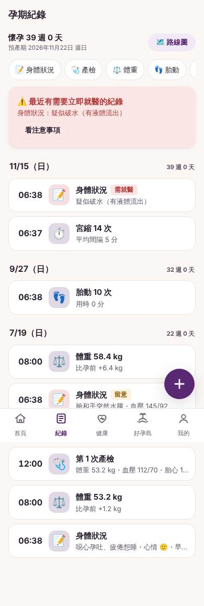

### 14. 生產紀錄

「寶寶出生了」：填出生時間、體重、身長、頭圍、生產方式，自動算出生週數。

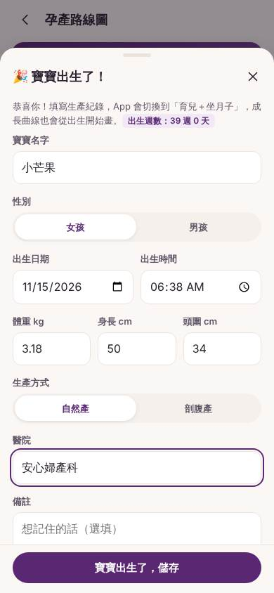

## 五、寶寶出生

### 15. 出生當天的首頁

自動切換到育兒：寶寶資料、快速紀錄、坐月子卡（產後第 1 天＋新生兒觀察）。

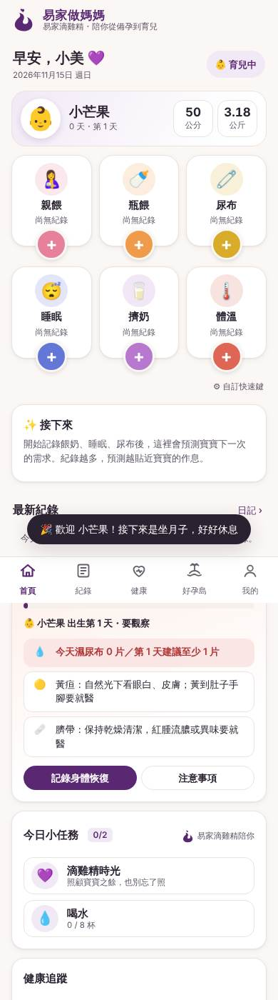

### 16. 產後身體恢復紀錄

坐月子：記錄惡露量與顏色、傷口疼痛、體溫、心情。⚠️ 是要就醫的警訊。

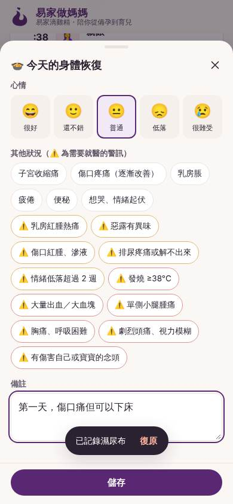

## 六、坐月子（產後 0–6 週）

### 17. 新生兒觀察

產後第 5 天：自動比對今天濕尿布數 vs 建議、體重變化、黃疸與臍帶提醒。

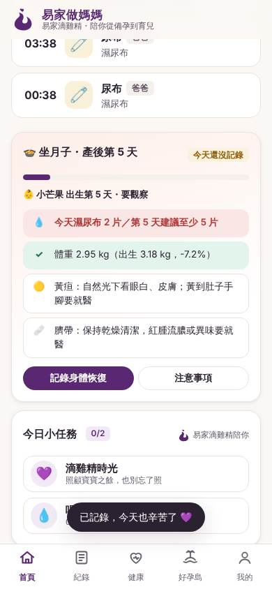

### 18. 產後警訊

記錄到發燒 38.4°C＋乳房紅腫熱痛（乳腺炎警訊）：提醒盡快就醫。

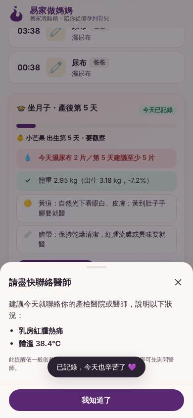

### 19. 預防保健

預防保健：先列「下一步要做的」（例：B型肝炎疫苗 第 1 劑），點一下標記完成。

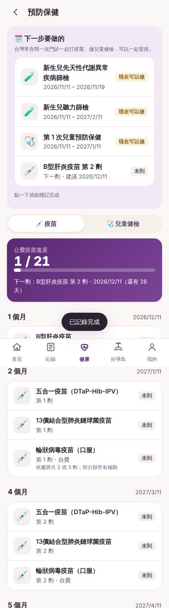

### 20. 產後恢復與情緒關懷

產後恢復頁：最近變化（心情、惡露顏色、疼痛）；兩週內多天低落會主動提供孕產婦關懷專線、安心專線。

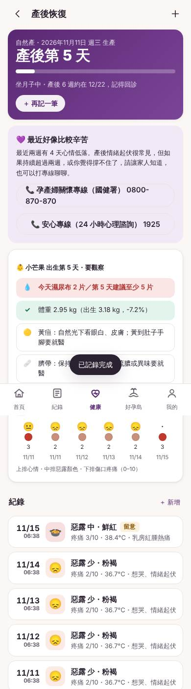

### 21. 路線圖完成

產後 6 週後：坐月子卡自動收起，路線圖顯示全部完成；之後回到一般育兒紀錄。

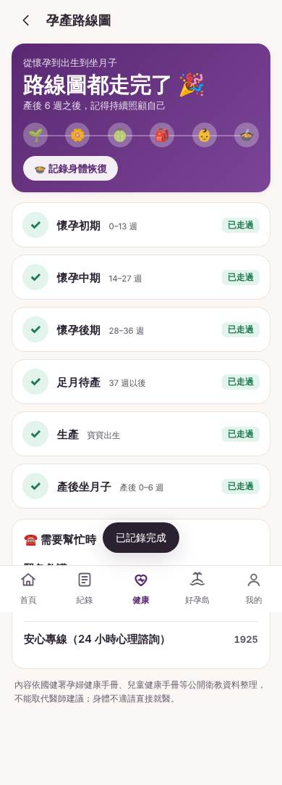

---

重新產生這份流程與截圖：先執行 `cd mom-app && python3 -m http.server 8080`，再另開終端機執行 `node tests/journey.playwright.cjs`（截圖會存到系統暫存資料夾，可用 `SHOT_DIR` 指定位置）。

內容為一般衛教資訊，不能取代醫師建議。
